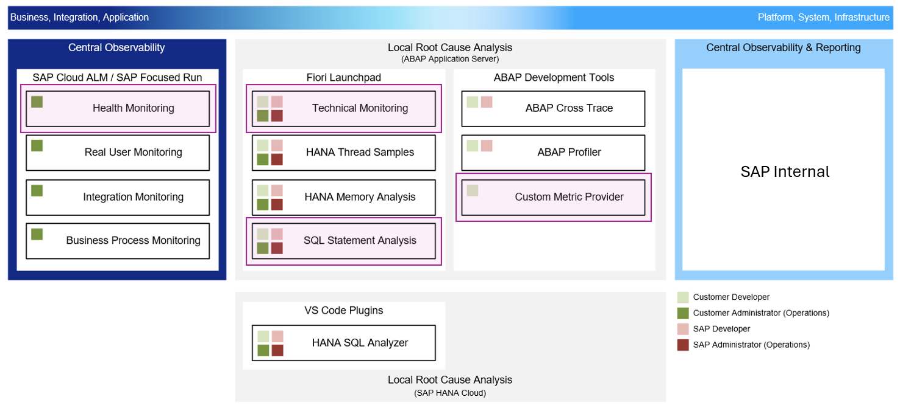

# AD261 - SAP Business AI Platform, ABAP environment: Monitoring and Troubleshooting
<!-- Internal repository for the HOW AD261 (fka **HOWAD3 > Steampunk**) at SAP TechEd 2026 -->

## Description

This repository contains the material for the SAP TechEd 2026 session called [AD261 | SAP BAIP, ABAP environment: Monitoring and troubleshooting](https://www.sap.com/events/teched/berlin/flow/sap/te26/catalog/page/catalog/session/1786351535346001BUjI).

Learn how to monitor and troubleshoot side-by-side applications built with the ABAP Cloud model on SAP BAIP, ABAP environment, aligning with a clean core strategy (level A). Use technical monitoring tools for an application based on ABAP Cloud and gain practical troubleshooting experience with ABAP development tools for Eclipse.

## Level

🧑‍🎓 Intermediate.

## Table of Contents

- [Overview](#overview)
- [Exercises](#exercises)
- [How to Obtain Support](#how-to-obtain-support)
- [Further Information](#further-information)

## Overview

Managing ABAP Cloud applications encompasses both platform operations and application-level operations. The SAP Business AI Platform, ABAP environment already supports platform-provided metrics in SAP Cloud ALM. In this workshop, you learn how to extend the platform observability model with your own application-layer metrics using **Custom Metric Providers** and **Health Monitoring** in **SAP Cloud ALM**.

 

In this session, you will create a small console application to generate ABAP short dumps and will build an ABAP RESTful Application Programming Model (RAP) application based on an example database table. With these ABAP objects, you will explore the [Technical Monitoring](https://help.sap.com/docs/btp/technical-monitoring-cockpit-cloud-version/technical-monitoring-cockpit-cloud-version) and the [Troubleshooting Tools](https://help.sap.com/docs/sap-btp-abap-environment/abap-environment/troubleshooting-tools).

## Exercises

The exercises follow a logical order and the created ABAP artifacts depend on each other.

| Exercise Block |
| --- |
| **Getting Started** |
| [Getting Started](exercises/getting-started/readme.md) |
| **Exercises for Monitoring and Analyzing Short Dumps** |
| [Exercise 1: Create a Console Application](exercises/exercise-01/readme.md) |
| [Exercise 2: Analyze ABAP Runtime Errors](exercises/exercise-02/readme.md) |
| **Exercises for OData Performance Analysis** |
| [Exercise 3: Create a Custom ABAP Cloud Application](exercises/exercise-03/readme.md) |
| [Exercise 4: Analyze OData Performance](exercises/exercise-04/readme.md) |
| **Exercises for Custom Metric Provider** |
| [Exercise 5: Create a Custom Metric Provider](exercises/exercise-05/readme.md) |
| [Exercise 6: Add Alert for Custom Metric in Health Monitoring](exercises/exercise-06/readme.md) |
| **Exercises for Integration Setup** |
| [Exercise 7: Inspect SAP Cloud ALM Integration (Optional)](exercises/exercise-07/readme.md) |
| **Exercises for ADT MCP Server** |
| [Exercise 8: Fix the COMPUTE_INT_ZERODIVIDE Runtime Error (Optional)](exercises/exercise-08/readme.md) |

## How to Obtain Support

Support for the content in this repository is available during the actual time of the online session for which this content has been designed. Otherwise, you may request support via the [Issues](../../issues) tab.

## Further Information

You can find more information about the product **SAP Business AI Platform, ABAP environment** and related topics here:

- [Product landing page with documentation, roadmap, and more](https://help.sap.com/docs/abap-cloud/abap-rap/abap-restful-application-programming-model)
- [Community landing page with events, news, and more](https://community.sap.com/topics/btp-abap-environment)

## Contributing

Please read the [CONTRIBUTING.md](./CONTRIBUTING.md) to understand the contribution guidelines.

## Code of Conduct

Please read the [SAP Open Source Code of Conduct](https://github.com/SAP-samples/.github/blob/main/CODE_OF_CONDUCT.md).

## How to obtain support

Support for the content in this repository is available during the actual time of the online session for which this content has been designed. Otherwise, you may request support via the [Issues](../../issues) tab.

## License

Copyright (c) 2026 SAP SE or an SAP affiliate company and teched2026-AD261 contributors. Please see our [LICENSE](LICENSE) for copyright and license information. Detailed information including third-party components and their licensing/copyright information is available [via the REUSE tool](https://api.reuse.software/info/github.com/SAP/teched2026-AD261).
