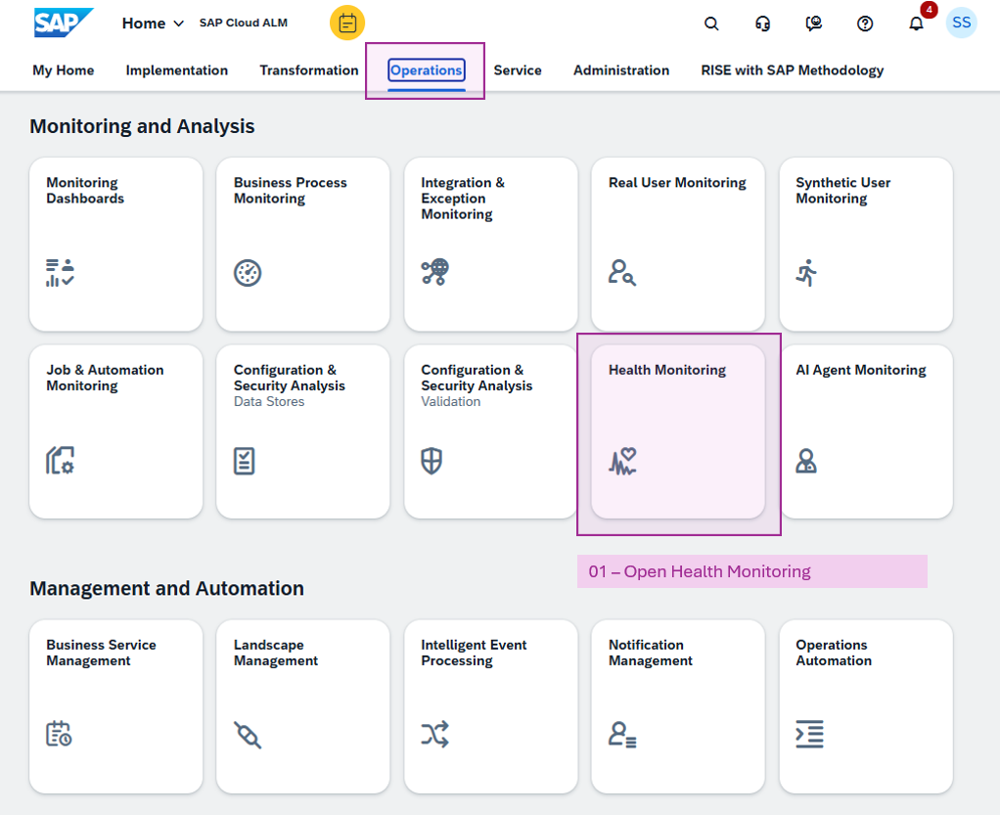
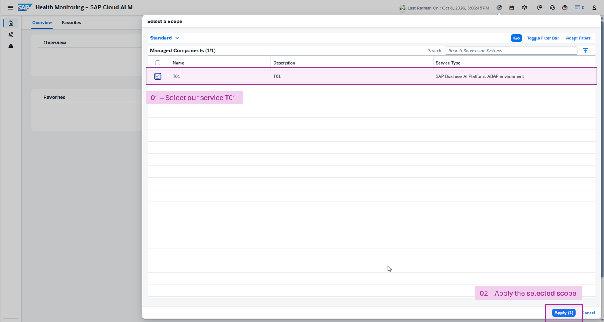
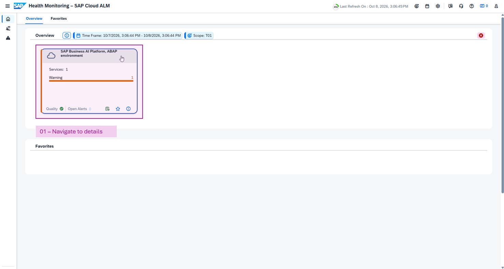
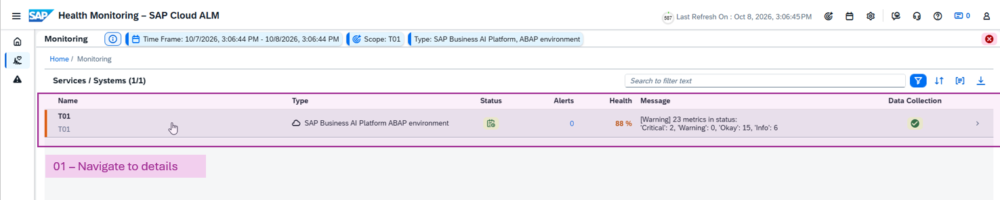

[Home - AD261](/README.md)

# Exercise 2: Analyze ABAP Runtime Errors

## Introduction

ABAP runtime errors are logged as **short dumps**. A short dump consists of different sections to support a root cause analysis after an ABAP runtime error has occurred (without debugging). The sections are:

- Header information
- What happened?
- Error analysis
- Information on where terminated
- Source Code Extract
- Active Calls/Events

There are different options to visualize short dump details and to retrieve statistics about the short dumps that have occurred:

- **Feed Reader** view in ADT
- **ABAP runtime errors** tile in Technical Monitoring SAP Fiori app
- **ABAP runtime 5 min interval** metric in SAP Cloud ALM

Only SAP Cloud ALM supports alerting on the occurrence of ABAP runtime errors.

In this exercise, you will use these three options to display the ABAP runtime errors generated in the previous exercise.

### Exercises

- [2.1 - Show Runtime Errors in ADT Feed Reader](#exercise-21-show-runtime-errors-in-adt-feed-reader)
- [2.2 - Show Runtime Errors in Technical Monitoring](#exercise-22-show-runtime-errors-in-technical-monitoring)
- [2.3 - Show Runtime Errors in SAP Cloud ALM](#exercise-23-show-runtime-errors-in-sap-cloud-alm)
- [Summary & Next Exercise](#summary-next-exercise)

## Exercise 2.1: Show Runtime Errors in ADT Feed Reader

> As a developer, use the [ADT Feed Reader view](https://help.sap.com/docs/abap-cloud/abap-development-tools-user-guide/feed-reader-view?version=sap_btp) to display the ABAP runtime errors generated with the console application in the previous exercise.

  
 🔵 Click to expand!

1. In ADT, open the **Feed Reader** view by clicking the respective tab. If the tab is not visible, open it via the Eclipse menu **Window** > **Show View** > **Other...**. Search for _feed reader_ or select **ABAP** > **Feed Reader**, and click **Open**. Expand the entries in the Feed Reader view below the current project.

2. The Feed Reader supports not only the visualization of runtime errors, but also **ABAP contract check violations** and **Gateway error log entries**. Since the focus of this exercise is on ABAP runtime errors, expand the feed query **Runtime Errors caused by me**.

3. Open the **Runtime Error Viewer** by double-clicking one of the runtime error entries. Navigate through the sections of the short dump, such as **Error analysis** and **Source Code Extract**. The source code line where the dump occurred is highlighted.

4. Familiarize yourself with how to navigate from the short dump information to the relevant code line in the class editor where the dump occurred.

## Exercise 2.2: Show Runtime Errors in Technical Monitoring

> As a system administrator, use the SAP Fiori apps of [Technical Monitoring](https://help.sap.com/docs/btp/technical-monitoring-cockpit-cloud-version/technical-monitoring-cockpit-cloud-version) to display the ABAP runtime errors of the entire tenant.

  
 🔵 Click to expand!

1. Open the SAP Fiori Launchpad for the system. There are different ways to obtain the respective URL. Since you are already logged on to ADT, use the ADT option. In ADT, go to the **Project Explorer**, right-click the entry for the system, and select **Properties** from the context menu. Select the category **ABAP Development** in the subsequent dialog and click the **System URL**.

2. Open the menu for **Administration** and select **Technical Monitoring**.

3. The Technical Monitoring offers around 20 apps. Open the app **ABAP Runtime Errors** in the first section **System Analysis**. The app is documented [here](https://help.sap.com/docs/btp/technical-monitoring-cockpit-cloud-version/abap-runtime-errors).

4. Set the **User ID** filter to display only the short dumps created by your user. The user ID has a format like CB998000nnnn. There are several options to look up your user ID. You can find your user ID either in the account settings of the SAP Fiori Launchpad or in the properties of your ABAP Cloud Project in ADT.

5. Open the details of a short dump and locate the **Source Code Extract** section.

6. Navigate from the Technical Monitoring app to the ABAP code location in ADT. Two navigation options are available: the button **ABAP Code Location (ADT)** in the **Source Code Extract** section, or the **ADT** button per line in the **Active Calls/Events** section.

> If the navigation to ADT does not work, you need to enable the Link Handler **adt**. Switch to **ADT**, open **Window** > **Preferences** (or in case of macOS: **Eclipse** > **Settings**), search for **link**, select **Link Handlers**, and enable the entry for **adt**.

## Exercise 2.3: Show Runtime Errors in SAP Cloud ALM

> As a landscape administrator, use SAP Cloud ALM to monitor ABAP runtime errors across all configured systems in the system landscape. SAP Cloud ALM is the recommended option for defining **alerts** when thresholds are exceeded.
>
> Currently, short dump details are not transferred from the tenant to the SAP Cloud ALM instance. The metric **ABAP Runtime Errors** (number of ABAP runtime errors during the last 5 minutes) can be used to configure alerting based on the number of dumps. A complete list of all SAP-delivered metrics is provided in the [Central Health Monitoring](https://help.sap.com/docs/sap-btp-abap-environment/abap-environment/central-health-monitoring-using-sap-focused-run-and-sap-cloud-alm) documentation.

  
 🔵 Click to expand!

1. Open the SAP Cloud ALM instance for your landscape. The URL is provided in the session material in [Getting Started](../getting-started/readme.md).

   > As individual tenants are registered and configured within the SAP Cloud ALM instance, there is no reference in the other direction. This means there is currently no option to retrieve the SAP Cloud ALM URL from within ADT or the Technical Monitoring app.

2. Select the tab **Operations** and open the app **Health Monitoring**.

    

3. When you first enter Health Monitoring, you must select a **scope**. The screen presents all services connected to the SAP Cloud ALM instance. Choose `T01` as the scope.

    

4. The tile **SAP Business AI Platform, ABAP environment** summarizes the monitoring data for all registered tenants of the product. Click the tile header to navigate to the details, which display a list of the registered tenants.

    

5. Click the tenant that represents the development tenant `T01` to display the values of all SAP-delivered metrics.

    

6. One of the metrics is **ABAP Runtime Errors**. Clicking the metric tile displays the number of ABAP runtime errors during the last 5 minutes, grouped by error type.

7. Navigate into the details of error type **COMPUTE_INT_ZERODIVIDE**. Click the **History** button to review earlier 5-minute time intervals.

## Summary & Next Exercise

Now that you have an overview of how to gain insights into ABAP runtime errors and how to monitor them, continue with the next exercise ► **[Exercise 3: Create a Custom ABAP Cloud Application](../exercise-03/readme.md)**.