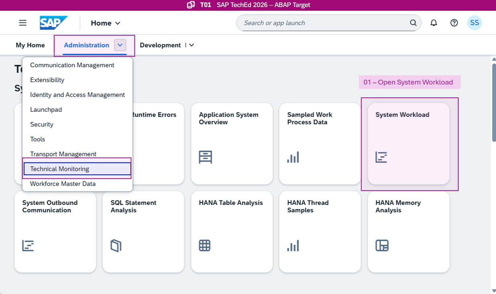
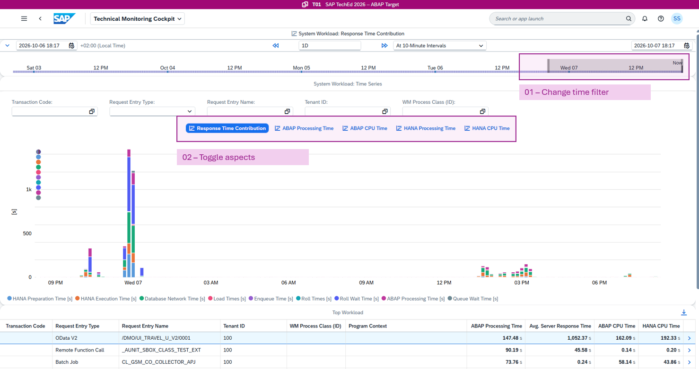
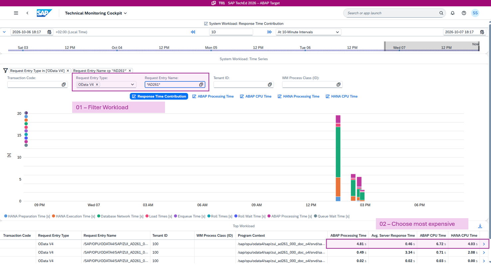
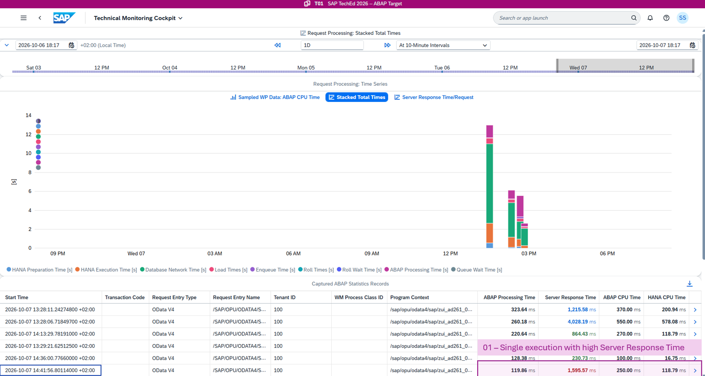
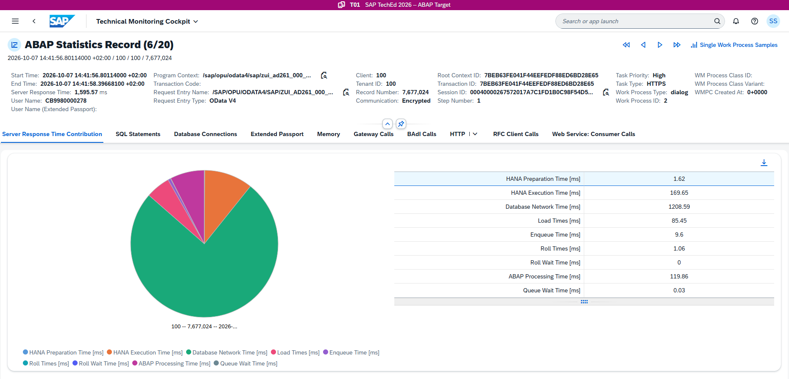
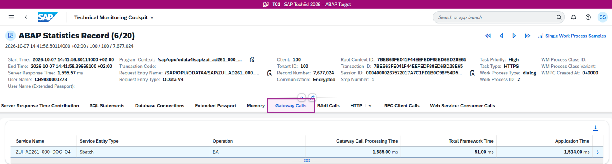
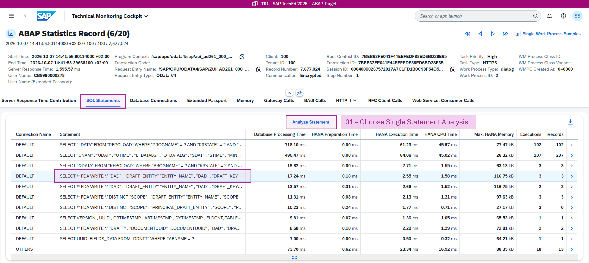
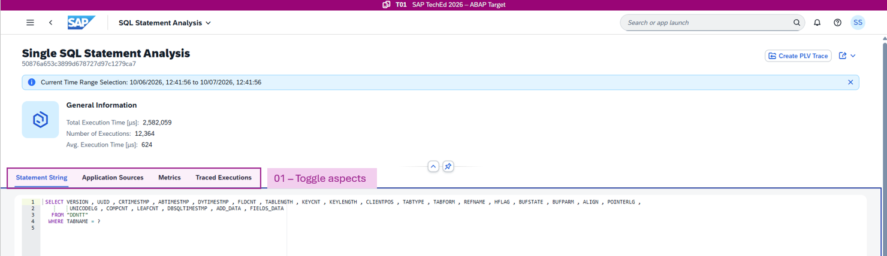

[Home - AD261](/README.md)

# Exercise 4: Analyze OData Performance

## Introduction

In the previous exercise, you implemented a custom ABAP Cloud application and tested it in preview mode. Testing the application already created various traces in the backend system. In this exercise, you analyze the `T01` system workload, inspect single executions, and understand the SQL workload of OData services.

In this exercise, you will:

1. Inspect the system workload
2. Analyze a single OData service execution
3. Understand the SQL statements in context of the OData service

### Exercises

- [Exercise 4.1: Inspect the System Workload](#exercise-41-inspect-the-system-workload)
- [Exercise 4.2: Analyze a Single OData Service Execution](#exercise-42-analyze-a-single-odata-service-execution)

## Exercise 4.1: Inspect the System Workload

> Using the System Workload app, you can navigate seamlessly from a workload overview down to individual ABAP statistics records — including main records, subrecords, SQL statements, and their execution plans. This makes it an excellent starting point for performance analysis. For records with high database response times, you can drill down to SAP HANA level; for records where ABAP CPU time is the bottleneck, a HANA-level analysis is not necessary.

  
🔵 Click to expand!

 

1. **Open System Workload**

In the Fiori Launchpad, in the **Administration** space, choose **Technical Monitoring**.

Open the **System Workload** by clicking the tile. Alternatively, search for the Fiori app **System Workload**.

 

 

2. **Change analysis aspects**

In the upper section, you can change the time filters. Explore the filter bar and toggle the analysis aspects:

* Response Time Contribution
* ABAP Processing Time
* ABAP CPU Time
* HANA Processing Time
* HANA CPU Time

 

3. **Filter for OData services**

In the filter section, choose the following conditions:

* Request Entry Type: **OData V4**
* Request Entry Name: **\*AD261\***

 

The lower table sorts OData services in descending order by **ABAP Processing Time**. Choose the top service and open the details section.

4. **Analyze Request Processing**

By opening the detail section from the previous step, you navigate to the single request processing time series. The workload is filtered for exactly this one service and shows its processing time over time. The table lists all captured single executions. Choose an expensive execution to open the **Single Request Analysis**.

 

## Exercise 4.2: Analyze a Single OData Service Execution

> Starting from the system workload, you drill into a single request execution to understand its response time breakdown and the SQL statements it triggered.

  
🔵 Click to expand!

 

1. **Open ABAP Statistics Record Analysis**

Starting from the system workload, you navigate from a filtered service to a single request execution and continue in the **ABAP Statistics Record** view.

An ABAP statistics record captures information about a request, such as the response time and the request entry name. These records provide the data behind the System Workload app screens.

**What are ABAP Statistics Records?**

By default, requests in the ABAP environment are recorded with metrics such as server response time and CPU time. The resulting ABAP statistics records are written to the file system. They are well suited to investigating the performance or resource consumption of a system or tenant in detail, and to identifying the area causing problems when issues occur.

 

On the ABAP Statistics Record screen, you see a detailed breakdown of the response time: processing times, wait times, load times, database network time, and more. Available subrecord data is also displayed. Subrecords contain additional statistical data for individual aspects of the request — for example, if a database was accessed, there is a database connections subrecord. Other subrecords cover details such as expensive SQL statements, gateway calls, or memory consumption.

The pie chart shows how server response time is distributed across processing components. For details, see [Server Response Time Contribution](https://help.sap.com/docs/btp/technical-monitoring-cockpit-cloud-version/server-response-time-contribution).

2. **Gateway Calls**

The **Gateway Calls** section shows the specific metrics from OData processing. In the exercise scenario, the **Application Time** reflects the SADL processing time for the business service request.

 

3. **SQL Statement Analysis**

SQL statements drive all data retrieval and modification on the SAP HANA database in your ABAP environment. When you develop or operate applications, analyzing the performance of their SQL statements is essential.

Check the **SQL Statements** section on the ABAP Statistics Record screen. The table shows the top SQL statements contributing to the HANA processing time.

> 💡 The SQL statements are available in the single record by default. You do not need to activate any tracing explicitly.

Select the entry and choose **Analyze Statement** to resolve the SQL statement:

 

The **Single SQL Statement Analysis** provides a formatted view of the SQL statement, performance metrics for different execution plans, and options to capture or view HANA PLV (Plan Visualization) files.

> 💡 The HANA PLV tracing is resource-intensive; schedule a trace using the **Capture Request Statistics** app or the ADT Cross Trace.

 

## References

- [Analyzing Performance Degradations in the ABAP Environment in the Cloud](https://community.sap.com/t5/technology-blog-posts-by-sap/analyzing-performance-degradations-in-the-abap-environment-in-the-cloud/ba-p/13557456)
- [Monitoring the Performance of Outbound Communication in the ABAP Environment in the Cloud](https://community.sap.com/t5/technology-blog-posts-by-sap/monitoring-the-performance-of-outbound-communication-in-the-abap/ba-p/13566730)
- [Capture Your Own Workload Statistics in the ABAP Environment in the Cloud](https://community.sap.com/t5/technology-blog-posts-by-sap/capture-your-own-workload-statistics-in-the-abap-environment-in-the-cloud/ba-p/13667180)
- [Analyze Expensive ABAP Workload in the Cloud with Work Process Sampling](https://community.sap.com/t5/technology-blog-posts-by-sap/analyze-expensive-abap-workload-in-the-cloud-with-work-process-sampling/ba-p/13675553)

## Summary & Next Exercise

In this exercise, you:
- analyzed the system workload and single executions
- investigated the SQL workload in the context of OData services

Congratulations! 🎉

You can now continue with the next exercise ► **[Exercise 5: Create a Custom Metric Provider](../exercise-05/readme.md)** where you create your own custom metric provider.
 
## License

Copyright (c) 2026 SAP SE or an SAP affiliate company. All rights reserved. This project is licensed under the Apache Software License, version 2.0 except as noted otherwise in the [LICENSE](/LICENSE) file.