[Home - AD261](/README.md)

# Exercise 5: Create a Custom Metric Provider

## Introduction

SAP Cloud ALM provides insights into the health of cloud services. The overview dashboard exposes all health monitoring metrics, and a detailed history is available for each one. While SAP ships a number of predefined metrics for operational monitoring, you can add your own application-specific metrics to monitor the health of customer or partner solutions running on the ABAP environment.

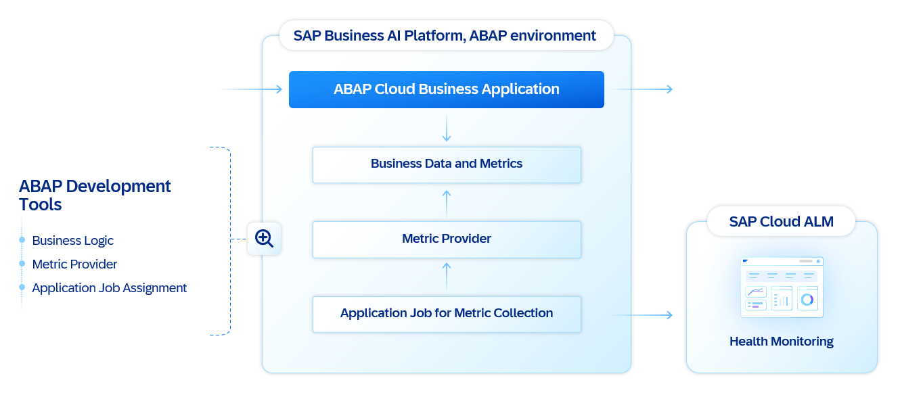<br/>

A custom metric provider is a development extension to the SAP Business AI Platform ABAP environment, implemented using ABAP Development Tools (ADT). The metric provider is technically a class that implements the metric model and metric measurement, registered as a metric provider development object.

In this exercise, you will:

1. Create a Class for Metric Provider
2. Define the Metric Model and Implement the Metric Measurement
3. Add the Metric Provider

### Exercises

- [Exercise 5.1: Create a Class for Metric Provider](#exercise-51-create-a-class-for-metric-provider)
- [Exercise 5.2: Create Metric Provider](#exercise-52-create-metric-provider)

## Exercise 5.1: Create a Class for Metric Provider

> To create a metric model for your customer or partner application, create a class in ABAP Development Tools (ADT) that implements the interface `IF_GSM_API_PROVIDER`. The class defines both the metric model and the metric measurement.

<details>
  <summary>🔵 Click to expand!</summary>
<br/>

1. **Create the Class**

In your ABAP Cloud project, in package `ZAD261_###`, create an ABAP class `ZCL_AD261_###_MP_PROVIDER` that implements the interface `IF_GSM_API_PROVIDER`.

<div align="right"></div>

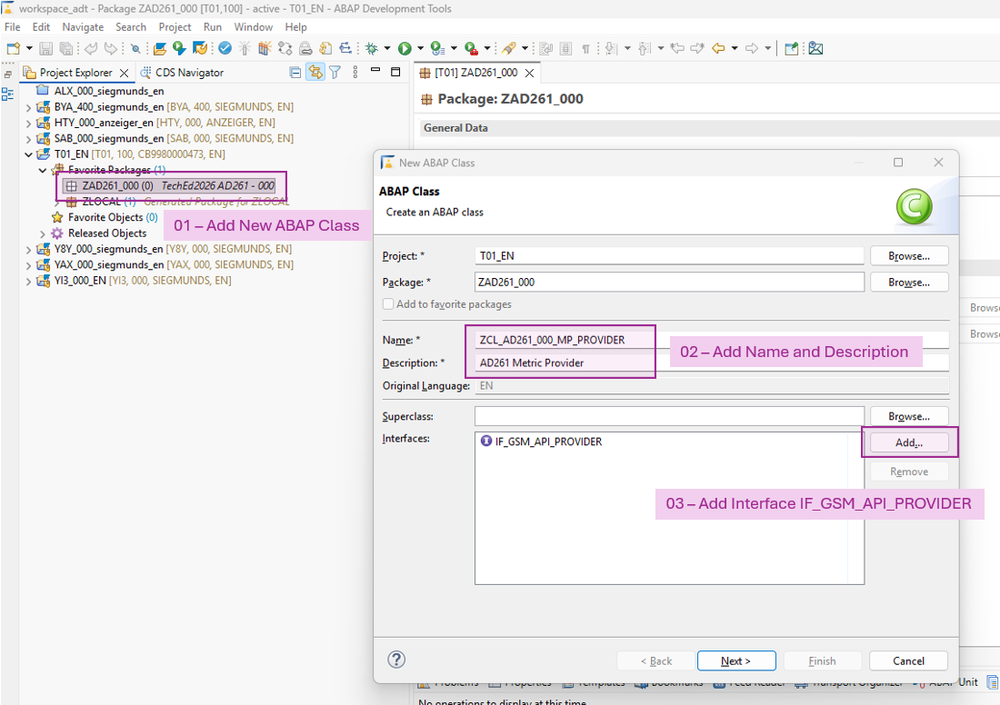<br/>

As a result, you get a class with the following methods: INITIALIZE( ), DEFINE_MODEL( ), and GET_METRIC_VALUES( ).

2. **Define Metric Constants**

When editing this class, define constants for the metric IDs used in both `DEFINE_MODEL( )` and `GET_METRIC_VALUES( )` — the IDs must match exactly between the two methods. Any metric ID that does not match is ignored at runtime.

Add the constants to the private section first. The metric IDs are not used outside the metric provider class.

For example, your code might look as follows:

```ABAP
CLASS zcl_ad261_###_mp_provider DEFINITION
  PUBLIC
  FINAL
  CREATE PUBLIC .

  PUBLIC SECTION.

    INTERFACES if_gsm_api_provider .

  PROTECTED SECTION.
  PRIVATE SECTION.

    CONSTANTS:
      BEGIN OF e_metric_group_id,
        zad261_###_group TYPE if_gsm_api_types=>tv_metric_group_id VALUE 'zad261_###_group',
      END OF e_metric_group_id .
    CONSTANTS:
      BEGIN OF e_metric_id,
        zad261_###_doc_errors_total TYPE if_gsm_api_types=>tv_metric_id VALUE 'zad261_###_doc_errors_total',
        zad261_###_demo_random      TYPE if_gsm_api_types=>tv_metric_id VALUE 'zad261_###_demo_random',
      END OF e_metric_id .
    CONSTANTS:
      BEGIN OF e_attribute_id,
        operation TYPE if_gsm_api_types=>tv_attribute_id VALUE 'operation',
      END OF e_attribute_id .

ENDCLASS.
```

3. **Define the Metric Model**

* Redefine the method `DEFINE_MODEL( )`.
* Register two metric IDs.
* Assign both to the target type `HEALTH`.

This target type has a critical integration role: it acts as the tag that instructs the SAP Cloud ALM exporter to periodically export all marked metrics to the connected SAP Cloud ALM instance.

The inline comments in the sample code below explain each definition in more detail — including metric categories, target types, periods, and the difference between gauge and counter metric types.

```ABAP
  METHOD if_gsm_api_provider~define_model.

    " metric group
    " -------------------------------------------------------------------------
    " A metric group logically organizes related metrics. Shared properties —
    " such as the target type — are defined once on the group and automatically
    " inherited by every metric added to it.

    DATA(metric_group) = io_model->add_metric_group(
      iv_metric_group_id   = me->e_metric_group_id-zad261_###_group
      iv_metric_group_name = `Demo Health Metric Provider` ##NO_TEXT
      iv_category          = if_gsm_api_constants=>e_category-performance ).

    " target type
    " -------------------------------------------------------------------------
    " The target type is an integration tag. Any metric whose target type is
    " set to "HEALTH" is picked up by the SAP Cloud ALM exporter and
    " periodically pushed to all attached SAP Cloud ALM instances.

    metric_group->add_target(
      iv_target_type       = if_gsm_api_constants=>e_target_type-health ).

    " metric definition
    " -------------------------------------------------------------------------
    " A metric has various attributes: unit, period, name, and description.
    "
    " The metric type used here is GAUGE. A gauge represents a single
    " numerical value that can go up and down — a snapshot of the current
    " state. Think of a car's speedometer: it shows the current speed, not
    " the total distance traveled.
    "
    " A counter, by contrast, is a cumulative metric that only increments.
    " It never decreases, except when the system restarts and resets to zero.
    " Think of a car's odometer: it records the total miles driven.

    DATA(metric_001) = metric_group->add_metric(
      iv_metric_id         = me->e_metric_id-zad261_###_doc_errors_total
      iv_metric_name       = `Document Errors in Total ###` ##NO_TEXT
      iv_unit              = if_gsm_api_constants=>e_unit-counter
      iv_data_type         = if_gsm_api_constants=>e_data_type-integer
      iv_period            = if_gsm_api_constants=>e_period-every_01_minute
      iv_description       = `Document Errors in Total ###`  ##NO_TEXT
      iv_metric_type       = if_gsm_api_constants=>e_metric_type-gauge ).

    DATA(metric_002) = metric_group->add_metric(
      iv_metric_id         = me->e_metric_id-zad261_###_demo_random
      iv_metric_name       = `Random Health Metric ###` ##NO_TEXT
      iv_unit              = if_gsm_api_constants=>e_unit-counter
      iv_data_type         = if_gsm_api_constants=>e_data_type-integer
      iv_period            = if_gsm_api_constants=>e_period-every_01_minute
      iv_description       = `Just a demo`  ##NO_TEXT
      iv_metric_type       = if_gsm_api_constants=>e_metric_type-gauge ).

  ENDMETHOD.
```

---

4. **Implement the Metric Measurement**

Two measurement strategies are implemented: one that captures a snapshot of document states from the ABAP Cloud business application, and one that generates random values for demo purposes only.

First, add the two sub-methods to the private section of the class.

```ABAP
    METHODS get_metric_doc_errors
      IMPORTING
        iv_timestamp_start TYPE timestamp OPTIONAL
        iv_timestamp_end   TYPE timestamp OPTIONAL
        it_metrics         TYPE if_gsm_api_types=>tt_metrics
      CHANGING
        ct_metric_values   TYPE if_gsm_api_types=>tt_metric_values
        ct_messages        TYPE if_gsm_api_types=>tt_messages
      RAISING
        cx_gsm_api .

    METHODS get_metric_demo_random
      IMPORTING
        iv_timestamp_start TYPE timestamp OPTIONAL
        iv_timestamp_end   TYPE timestamp OPTIONAL
        it_metrics         TYPE if_gsm_api_types=>tt_metrics
      CHANGING
        ct_metric_values   TYPE if_gsm_api_types=>tt_metric_values
        ct_messages        TYPE if_gsm_api_types=>tt_messages
      RAISING
        cx_gsm_api .
```

Implement `if_gsm_api_provider~get_metric_values( )` to delegate each metric's measurement to its dedicated sub-method. This keeps the logic for each metric self-contained and easy to extend.

```ABAP
  METHOD if_gsm_api_provider~get_metric_values.

    me->get_metric_doc_errors(
      EXPORTING
        iv_timestamp_start = iv_timestamp_start
        iv_timestamp_end   = iv_timestamp_end
        it_metrics         = it_metrics
      CHANGING
        ct_metric_values   = et_metric_values
        ct_messages        = et_messages ).

    me->get_metric_demo_random(
      EXPORTING
        iv_timestamp_start = iv_timestamp_start
        iv_timestamp_end   = iv_timestamp_end
        it_metrics         = it_metrics
      CHANGING
        ct_metric_values   = et_metric_values
        ct_messages        = et_messages ).

  ENDMETHOD.
```

Metric `doc_errors_total` reflects the number of documents processed by the ABAP Cloud business application. It counts the number of open documents currently in an error state.

```ABAP
  METHOD get_metric_doc_errors.

    DATA: current_timestamp TYPE timestamp.

    " initialize metric value structure
    " -------------------------------------------------------------------------
    " Prepare the metric value structure and add a reference for the attribute
    " values table.

    GET TIME STAMP FIELD current_timestamp.

    DATA(metric_value) = VALUE if_gsm_api_types=>ts_metric_value(
      metric_id       = me->e_metric_id-zad261_###_doc_errors_total
      value_timestamp = current_timestamp
      value_count     = 1
    ).

    INSERT VALUE #(
      attribute_id = me->e_attribute_id-operation
      value        = 'None' ##NO_TEXT
    ) INTO TABLE metric_value-attributes
      REFERENCE INTO DATA(metric_attr_01).

    " metric data
    " -------------------------------------------------------------------------
    " Retrieval of the metric values at this point in time.

    SELECT SINGLE COUNT( * ) AS doc_error_count
      FROM zr_ad261_###_doc
     WHERE status = 'E'
      INTO @DATA(doc_error_count).

    " transformation
    " -------------------------------------------------------------------------
    " Transform the metric values format to the GSM data structures.

    metric_value-value_sum = doc_error_count.
    metric_value-value_max = metric_value-value_sum.
    metric_value-value_min = metric_value-value_sum.

    IF metric_value-value_sum > 10.
      metric_value-value_rating = if_gsm_api_constants=>e_rating-_2_warning.
    ELSE.
      metric_value-value_rating = if_gsm_api_constants=>e_rating-_1_ok.
    ENDIF.

    INSERT metric_value INTO TABLE ct_metric_values.

  ENDMETHOD.
```

Metric `demo_random` uses the `CL_ABAP_RANDOM` class to generate random values for demo purposes. The wider value distribution better illustrates how SAP Cloud ALM renders and handles chart data over time. Two attribute values — `Read` and `Write` — are added to the `operation` attribute, creating two separate time series in SAP Cloud ALM.

```ABAP
  METHOD get_metric_demo_random.

    DATA: current_timestamp TYPE timestamp.

    " random
    " -------------------------------------------------------------------------
    " Generate random metric values for demo purposes.

    GET TIME STAMP FIELD current_timestamp.

    DATA(abap_random) = cl_abap_random_int=>create(
      seed = cl_abap_random=>seed( )
      min  = 10
      max  = 100
    ).

    INSERT VALUE if_gsm_api_types=>ts_metric_value(
      metric_id       = me->e_metric_id-zad261_###_demo_random
      value_timestamp = current_timestamp
      value_count     = 1
      value_sum       = abap_random->get_next( )
      value_rating    = if_gsm_api_constants=>e_rating-_1_ok
      attributes      = VALUE if_gsm_api_types=>tt_attributes(
        ( attribute_id = me->e_attribute_id-operation
          value        = 'Read' )
      )
     ) INTO TABLE ct_metric_values.

    INSERT VALUE if_gsm_api_types=>ts_metric_value(
      metric_id       = me->e_metric_id-zad261_###_demo_random
      value_timestamp = current_timestamp
      value_count     = 1
      value_sum       = abap_random->get_next( )
      value_rating    = if_gsm_api_constants=>e_rating-_1_ok
      attributes      = VALUE if_gsm_api_types=>tt_attributes(
        ( attribute_id = me->e_attribute_id-operation
          value        = 'Write' )
      )
     ) INTO TABLE ct_metric_values.

  ENDMETHOD.
```

5. **Add `INITIALIZE( )`**

Some scenarios require a dedicated initialization phase when the metric provider is created. In this simple exercise scenario, add an empty implementation for the `INITIALIZE( )` method.

```ABAP
  METHOD if_gsm_api_provider~initialize.
  ENDMETHOD.
```

6. **Add Test Cases**

Add a very simple test case to the metric provider. Use the helper class `CL_GSM_API_TEST` to run the metric provider model definition including the measurements. You can then compare precise metrics or use a simple existence check for the provided metrics. This exercise uses the simpler check.

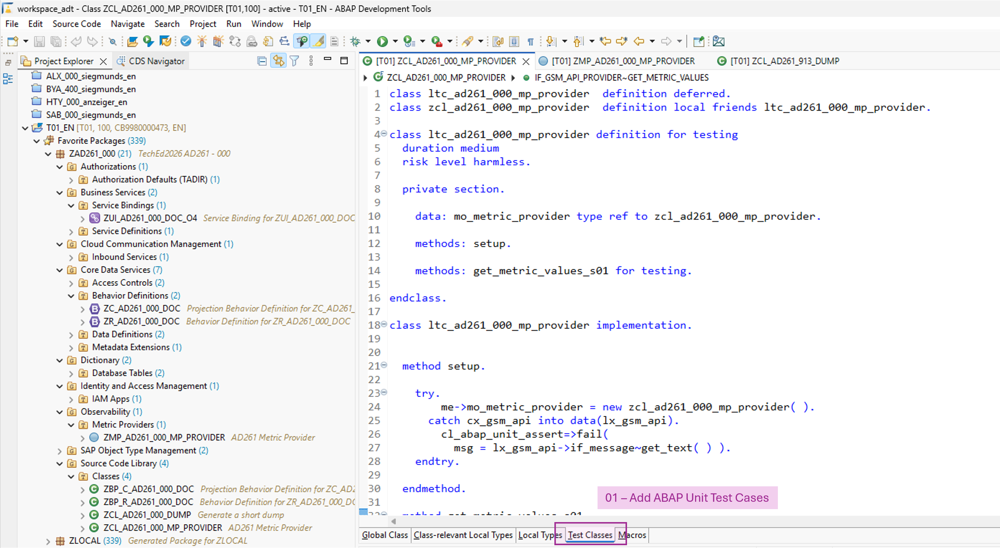<br/>

```ABAP
class ltc_ad261_###_mp_provider  definition deferred.
class zcl_ad261_###_mp_provider  definition local friends ltc_ad261_###_mp_provider.

class ltc_ad261_###_mp_provider definition for testing
  duration medium
  risk level harmless.

  private section.

    data: mo_metric_provider type ref to zcl_ad261_###_mp_provider.

    methods: setup.

    methods: get_metric_values_s01 for testing.

endclass.

class ltc_ad261_###_mp_provider implementation.


  method setup.

    try.
        me->mo_metric_provider = new zcl_ad261_###_mp_provider( ).
      catch cx_gsm_api into data(lx_gsm_api).
        cl_abap_unit_assert=>fail(
          msg = lx_gsm_api->if_message~get_text( ) ).
    endtry.

  endmethod.

  method get_metric_values_s01.

    " scenario
    " -------------------------------------------------------------------------
    " Simple test with mocked API and complete verify.

    try.
        " prepare
        " ---------------------------------------------------------------------

        data(lo_api_test) = cl_gsm_api_test=>get_instance( ).

        " execute
        " ---------------------------------------------------------------------

        lo_api_test->get_metric_values(
          exporting
            io_provider      = me->mo_metric_provider
          importing
            et_metric_values = data(lt_metric_values_act)
            et_messages      = data(lt_messages) ).

        " verify
        " ---------------------------------------------------------------------
        " Dedicated test with literals to detect potential changes for constant
        " values.

        lo_api_test->assert_metrics_exist(
          it_metric_values_act = lt_metric_values_act
          it_metrics           = value #(
            ( metric_id = zcl_ad261_###_mp_provider=>e_metric_id-zad261_###_doc_errors_total )
            ( metric_id = zcl_ad261_###_mp_provider=>e_metric_id-zad261_###_demo_random )
          ) ).

      catch cx_gsm_api into data(lx_gsm_api).
        cl_abap_unit_assert=>fail(
          msg = lx_gsm_api->if_message~get_text( ) ).
    endtry.

  endmethod.
endclass.
```

Run the ABAP unit test cases in ADT. You can check the results or debug the runtime code to better understand the execution of the metric measurement.

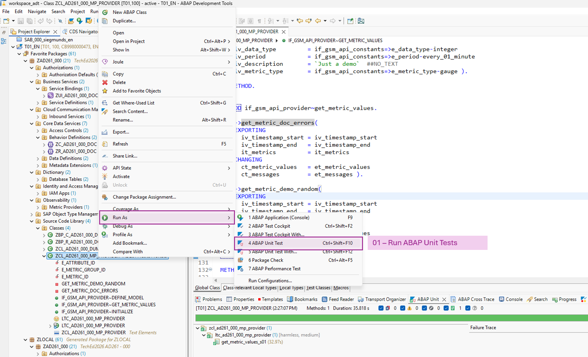

 </details>

## Exercise 5.2: Create Metric Provider

> You can create a metric provider in ABAP Development Tools to make your own metrics available for health monitoring of your ABAP system.

<details>
  <summary>🔵 Click to expand!</summary>
<br/>

1. **Create the Metric Provider**

To create a metric provider in ABAP Development Tools, choose **New** → **Other ABAP Repository Object** → **Observability** → **Metric Provider**.

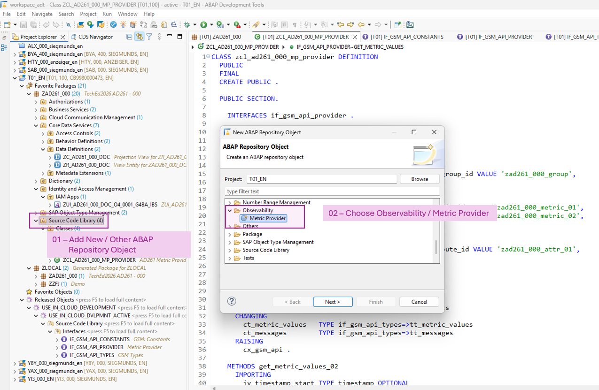<br/>

Enter `ZMP_AD261_###_MP_PROVIDER` as the name of the metric provider and provide a description `AD261 Metric Provider`.

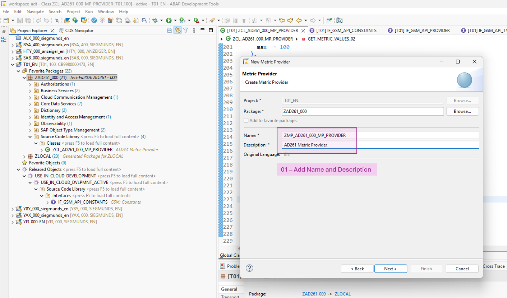<br/>

As the implementing object, enter the class `ZCL_AD261_###_MP_PROVIDER`, which contains the metric model for this provider.

The execution mode is fixed to **Job** and cannot be changed. Metric values are collected by an application job that your administrator must schedule. The job runs regularly and calls the `GET_METRIC_VALUES( )` method of every registered metric provider.

Assign a higher priority to metric providers you consider more important. A higher priority ensures their values are collected first. If one metric provider depends on the values of another, give the dependency a higher priority than the dependent provider.

Leave the **Scope Dependent** field set to **No**.

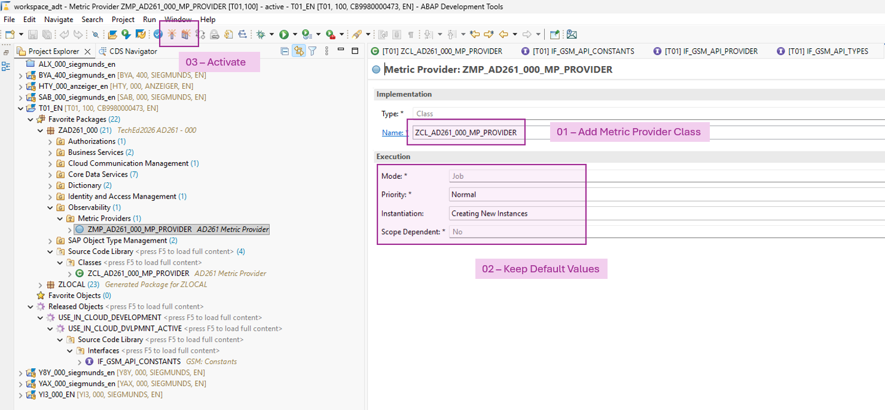<br/>

2. **Metric Collector Job**

As an administrator, you must schedule the application job **Collect Metric Provider Values** to periodically run all metric providers and store their values in the generic metric store. From there, the values can be pushed to SAP Cloud ALM.

A single application job runs all registered metric providers. To avoid lock contention during the hands-on session, this job has already been scheduled on the demo system with a 1-minute interval. For details on the scheduling, see [Collect Metric Provider Values (Administrator)](https://help.sap.com/docs/btp/sap-business-technology-platform/collect-metric-provider-values-administrator).

<div align="right"><br/></div>

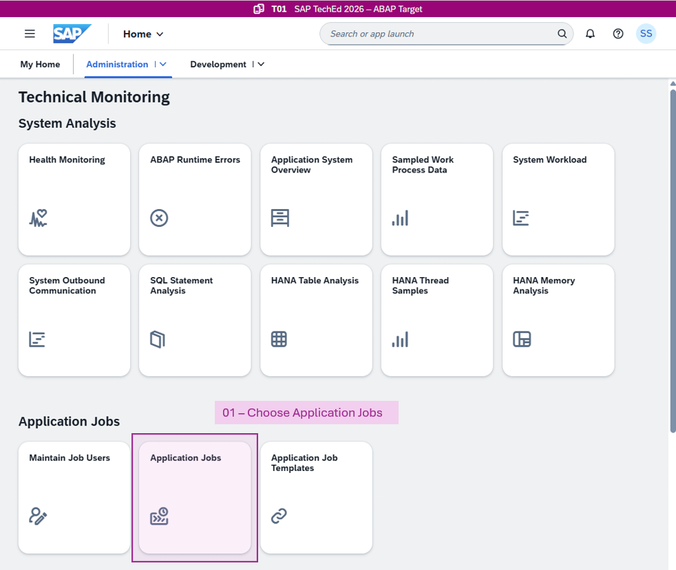<br/>

Filter the list to one specific execution of the metric collector job.

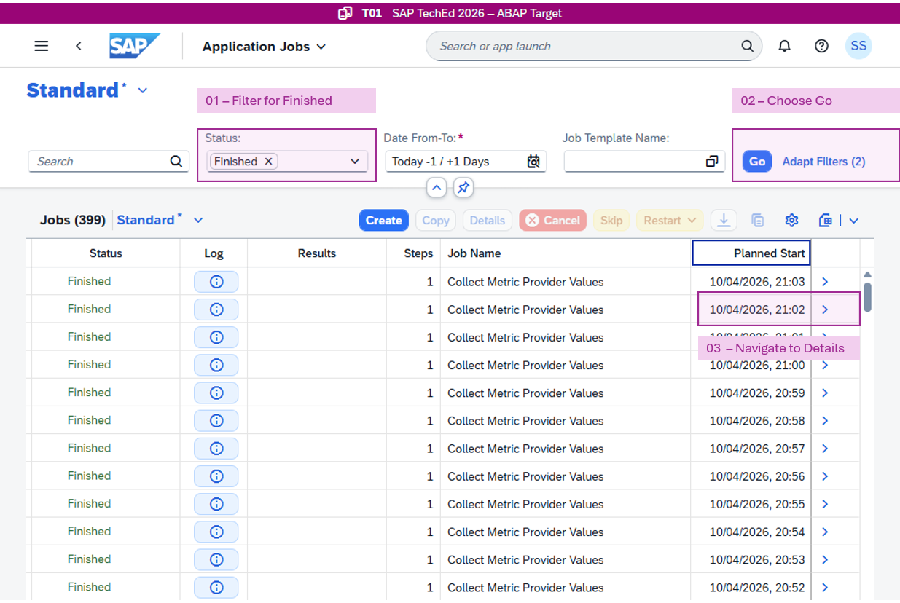<br/>

On the job details page, navigate to the detailed log section.

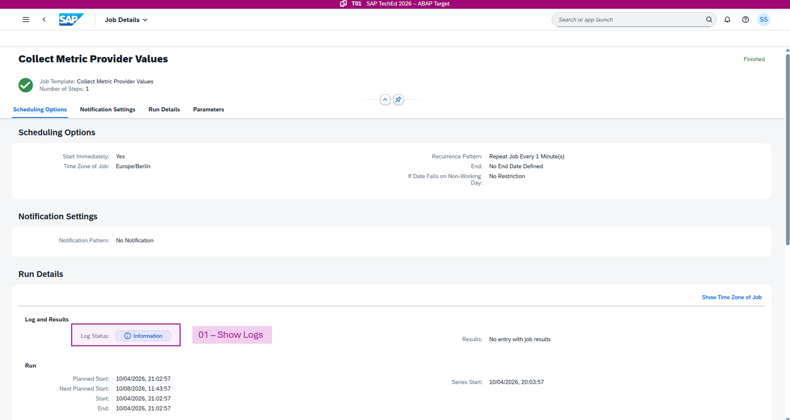<br/>

The log describes which metric provider ran in this execution. It helps to understand the metric collection in general. If your metrics are not being collected as expected, use the following checks:

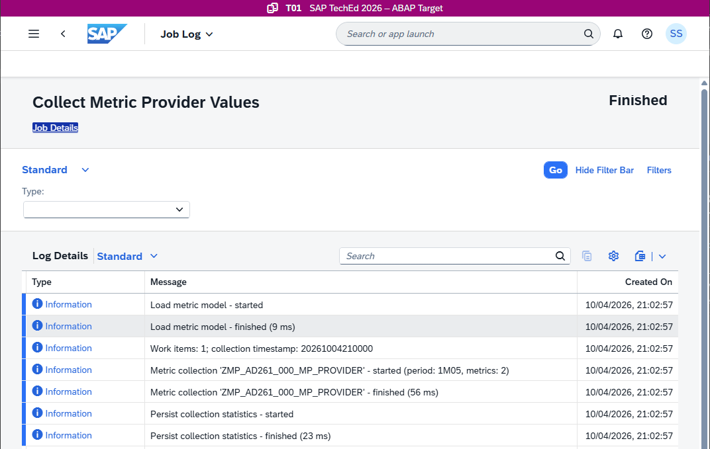<br/>

* Display the log of the application job **Collect Metric Provider Values**. In the log, search for **AD261_###** as the name of the metric provider.

* The log may also contain error messages indicating that metric providers have been banned, along with the reasons for the ban.

Background: If the metric provider framework detects any runtime violation — such as too many consecutive dumps, an exceeded runtime limit, or excessive memory consumption during metric value collection — the affected metric provider is banned for 24 hours. The ban protects the measurement of other metric providers. Fix the issues listed in the log. After 24 hours, the framework attempts to execute the provider once more in tentative mode. If the execution passes without issues, the ban is lifted; otherwise it is extended by another 24 hours.

</details>

## Summary & Next Exercise

In this exercise, you:
- implemented a metric provider including the metric model and measurements in an ABAP Cloud class
- tested the metric provider
- inspected the logs of the metric collection job

Congratulations! 🎉

You can now:
- continue with the next exercise ► **[Exercise 6: Add Alert for Custom Metric in Health Monitoring](../exercise-06/readme.md)** where you add an alert including email notification in SAP Cloud ALM.
- or **[↑ Back to Tutorial Home - AD261](/README.md)**.

## License

Copyright (c) 2026 SAP SE or an SAP affiliate company. All rights reserved. This project is licensed under the Apache Software License, version 2.0 except as noted otherwise in the [LICENSE](/LICENSE) file.