[Home - AD261](/README.md)

# Exercise 6: Add Alert for Custom Metric in Health Monitoring

## Introduction

In the previous exercise, you implemented a custom metric provider. In this exercise, you inspect the metric in SAP Cloud ALM using the default dashboards and add a custom alert definition including email notification.

### Exercises

- [Exercise 6.1: Inspect the Custom Metrics](#exercise-61-inspect-the-custom-metrics)
- [Exercise 6.2: Define Threshold and Email Notification](#exercise-62-define-threshold-and-email-notification)

## Exercise 6.1: Inspect the Custom Metrics

> The health monitoring exporter has already extracted the custom metric values and forwarded them to SAP Cloud ALM.

  
🔵 Click to expand!

 

1. **Health Monitoring**

 

Log on to the SAP Cloud ALM instance provided in [Getting Started](../getting-started/readme.md).

On the initial screen, navigate to the **Operations** section of SAP Cloud ALM. In the **Monitoring and Analysis** section, choose **Health Monitoring**. Select the service `T01` as done in [Exercise 2.3](../exercise-02/readme.md#exercise-23-show-runtime-errors-in-sap-cloud-alm).

The SAP-delivered standard metrics appear in the upper area. The metrics are documented in [Available Metrics for the ABAP Environment](https://help.sap.com/docs/btp/sap-business-technology-platform/central-health-monitoring-using-sap-focused-run-and-sap-cloud-alm). This blog provides guidance on reaction procedures for the different metrics: [Monitoring the Health of the ABAP System in the Cloud](https://community.sap.com/t5/technology-blog-posts-by-sap/monitoring-the-health-of-the-abap-system-in-the-cloud/ba-p/13570209).

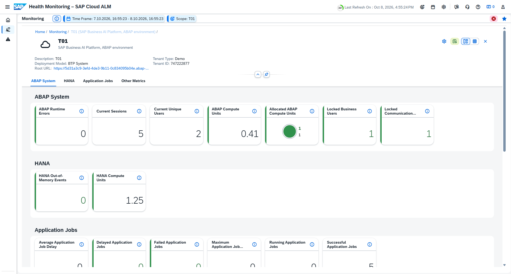 

2. **Custom Metrics**

The custom metrics are not assigned to a predefined group and are therefore collected in the **Other Metrics** section at the bottom of the page.

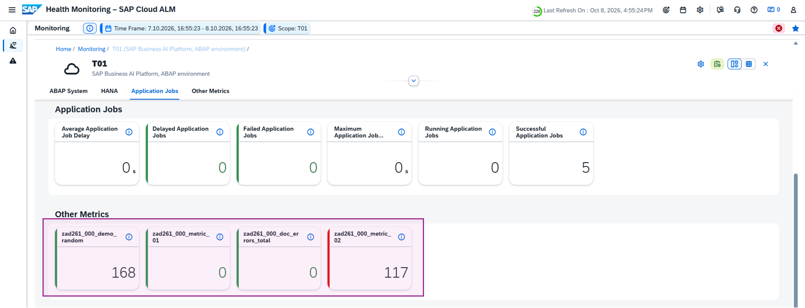 

To inspect your demo random metric, for example, choose the `zad261_###_demo_random` tile. The tile shows the aggregated values of both time series by default.

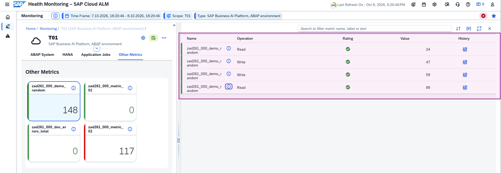 

Choose the history button next to a time series to view its values over time as a chart. The chart opens with a filter set to the exact metric ID and attribute combination for that time series.

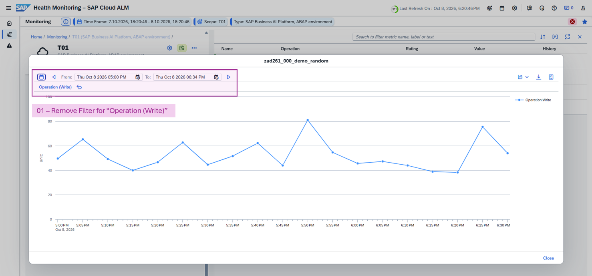 

Remove the drill-down filter and widen the time window to see all time series for your metric in parallel. Your metric contains only recent data. To explore a longer history, choose any other metric prefixed `zad261_###`, such as `zad261_###_demo_random`.

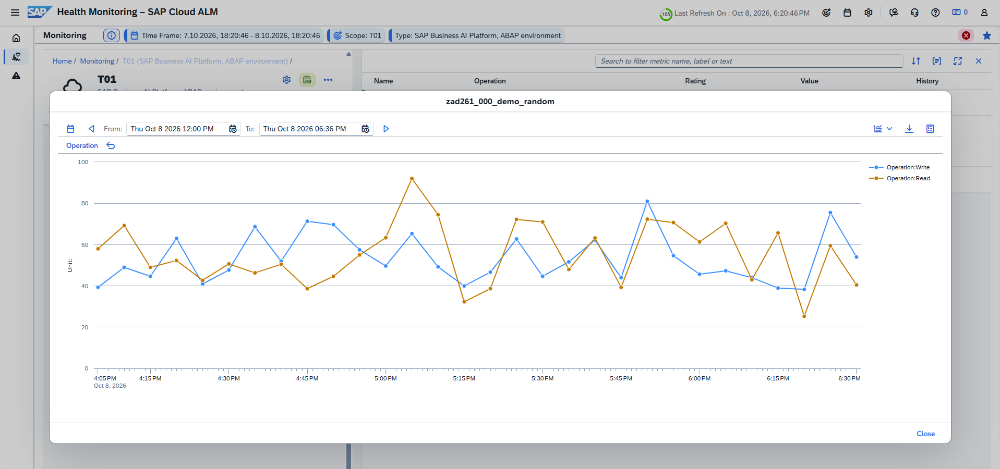 

## Exercise 6.2: Define Threshold and Email Notification

> If you use SAP Cloud ALM as your monitoring and alerting infrastructure, you can integrate ABAP environment monitoring into your existing operations. Using Health Monitoring, you can watch whether your ABAP environment is up and running and whether any exceptional situations have occurred. For exceptional situations, you define a threshold on the metric and optionally add an email notification.

  
🔵 Click to expand!

 

1. **Register Email for Notifications (optional)**

This step is optional. If you want to receive alert notifications by email, you must first register your email address in the SAP Cloud ALM instance. Note that other users in the system will see your email address as well. Only proceed if you agree to add your address to the system.

Open a second browser window and log on to the SAP Cloud ALM instance home screen.

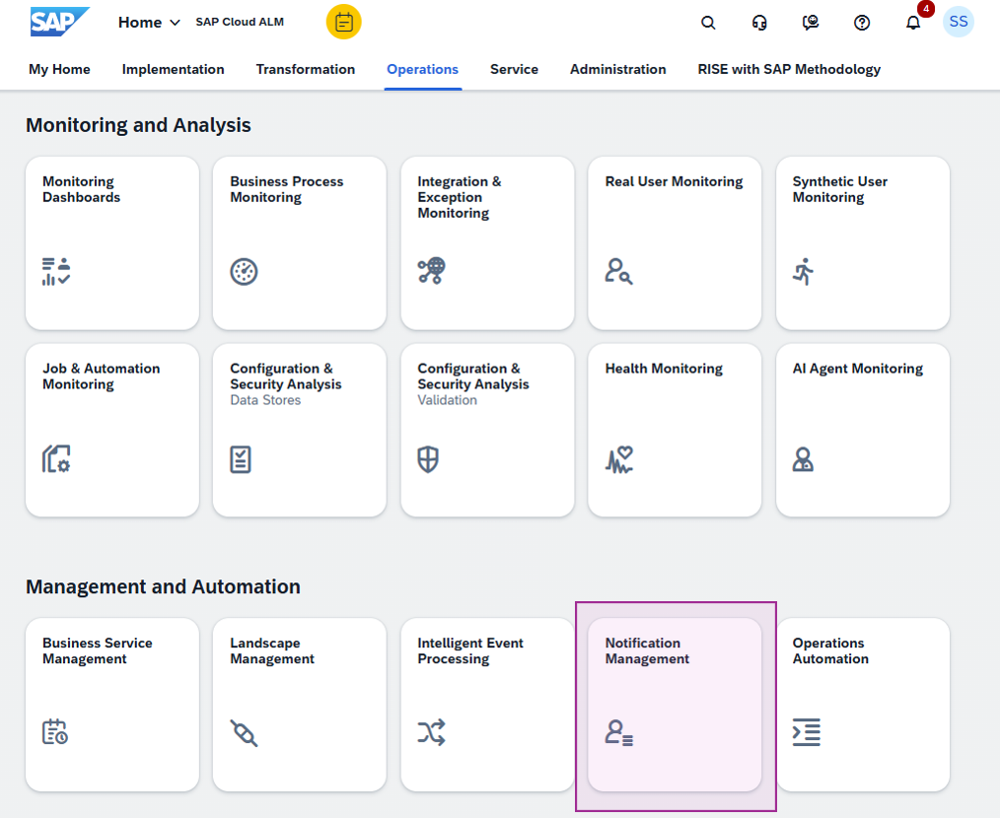 

Add your own email address for alert notifications and do not modify any other user's settings.

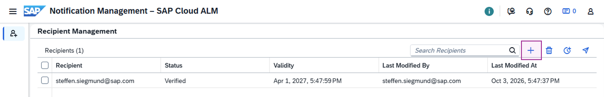 

You will receive a confirmation email from SAP Cloud ALM — approve it to verify your email address.

2. **Define Threshold Event**

Within the **Health Monitoring**, you open the configuration in the upper right area of the screen. It shows the services in the scope and an option to configure the system.

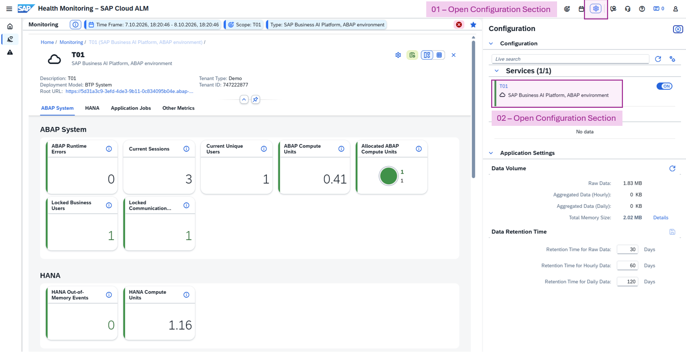 

The detailed metric view provides the option to add a threshold. Add a numeric threshold event for the metric `zad261_###_doc_errors_total`. Set warning at 1 document in error state and critical at 5.

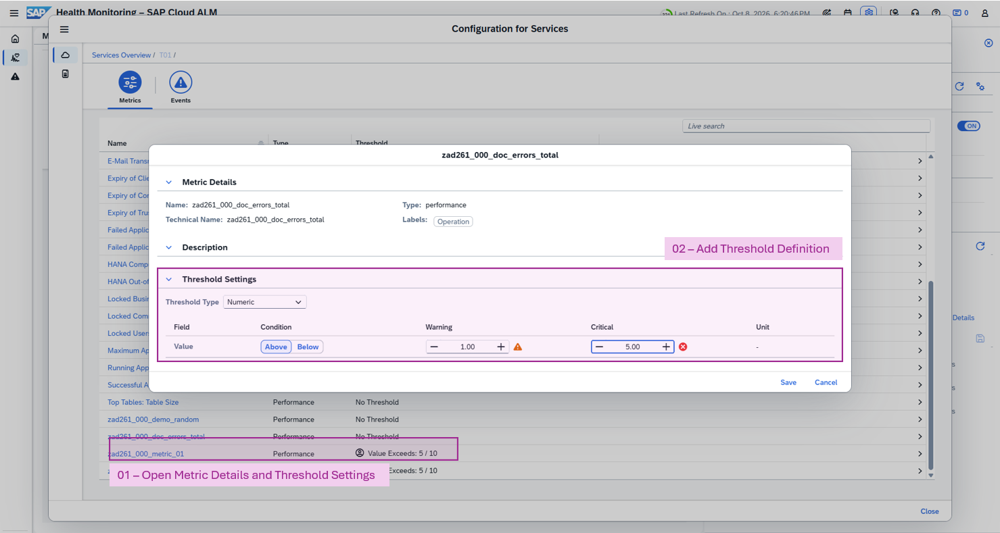 

Next, change to the **Events** section and add a new event named `ZAD261_###_EVENT_`.

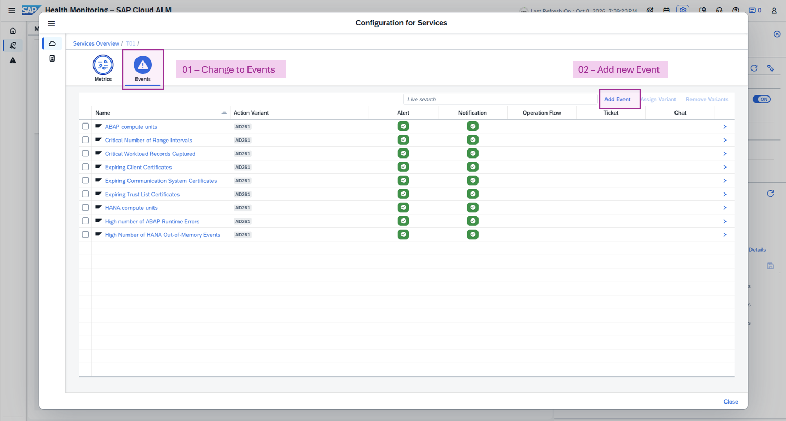 

In the metrics section, add your metric `zad261_###_doc_errors_total`. This binds the event to the metric and the defined threshold.

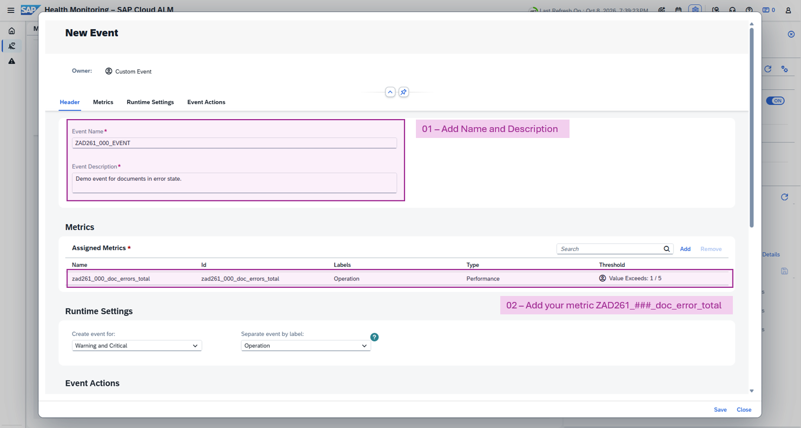 

Save the configuration and switch to the **Alert Reactions** section. Assign your email address as the notification recipient for the event `ZAD261_###_EVENT_`.

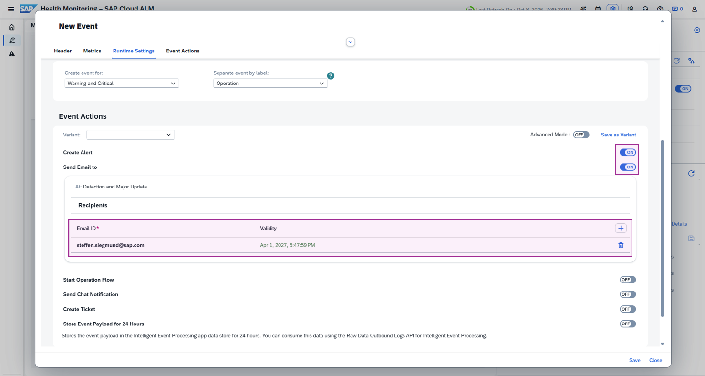 

When you set documents in the ABAP Cloud application to error state and the metric exceeds the threshold, you will see the threshold-based coloring on the tile and receive email notifications.

<kbd>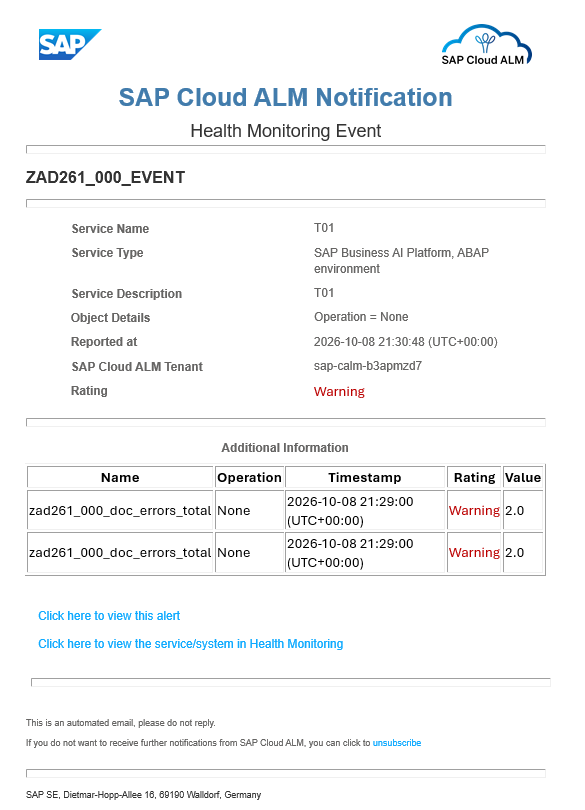 </kbd>

## Summary & Next Exercise

In this exercise, you:
- reviewed the custom metric from Exercise 5 in SAP Cloud ALM
- defined a threshold
- added an email notification

Congratulations! 🎉

You can now:
- continue with the next exercise ► **[Exercise 7: Inspect SAP Cloud ALM Integration](../exercise-07/readme.md)** where you understand the technical integration between the SAP Business AI Platform ABAP environment and SAP Cloud ALM
- or **[↑ Back to Tutorial Home - AD261](/README.md)**.

## License

Copyright (c) 2026 SAP SE or an SAP affiliate company. All rights reserved. This project is licensed under the Apache Software License, version 2.0 except as noted otherwise in the [LICENSE](/LICENSE) file.