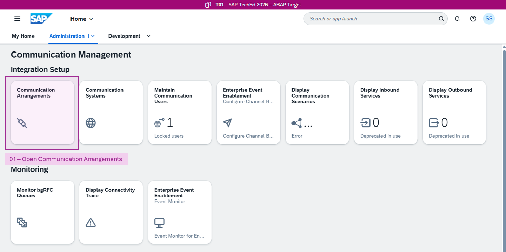
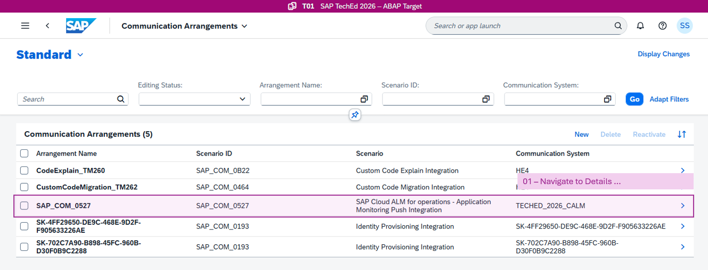
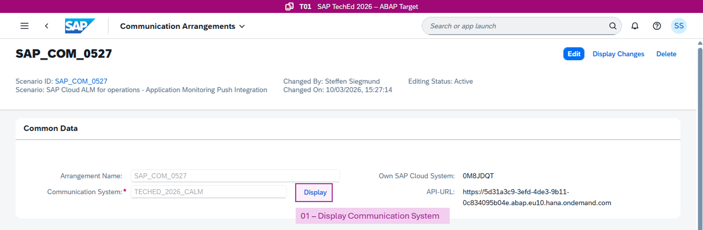
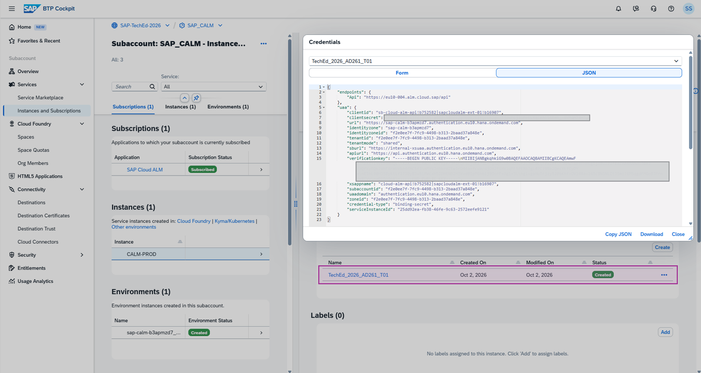
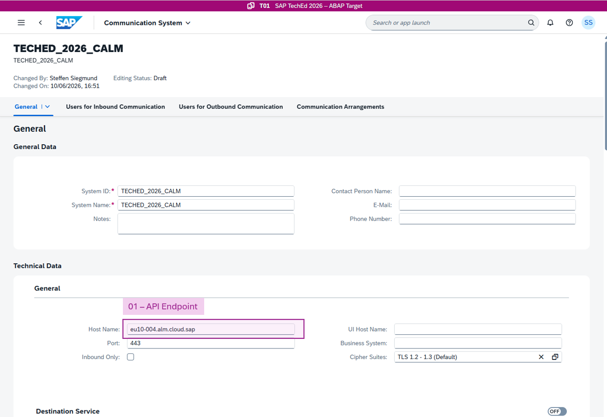
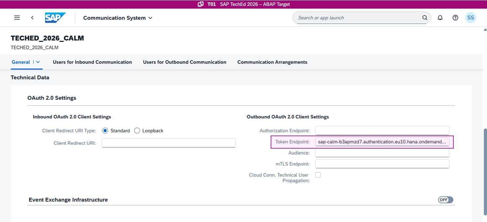
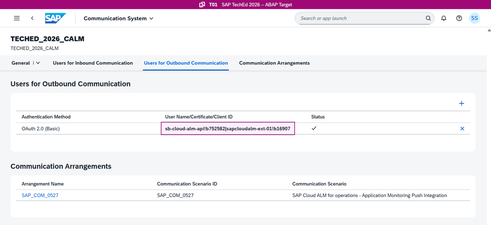

[Home - AD261](/README.md)

# Exercise 7: Inspect SAP Cloud ALM Integration

## Introduction

The integration between the SAP Business AI Platform, ABAP environment system T01 and the SAP Cloud ALM instance has already been configured. In this exercise, you inspect the configuration of the customer-managed communication scenario SAP_COM_0527.

### Exercises

- [Exercise 7.1: Inspect Communication Arrangement for SAP_COM_0527](#exercise-71-inspect-communication-arrangement-for-sap_com_0527)
- [Exercise 7.2: Inspect Communication System](#exercise-72-inspect-communication-system)

## Exercise 7.1: Inspect Communication Arrangement for SAP_COM_0527 (Optional)

> The communication scenario SAP_COM_0527 defines the outbound connectivity from the ABAP environment to SAP Cloud ALM. A communication arrangement based on this scenario has already been created for this workshop. In this step you inspect its configuration.

<details>
  <summary>🔵 Click to expand!</summary>
<br/>

1. **Open the Communication Arrangement for SAP_COM_0527**

In the SAP Fiori launchpad of service T01, open the app **Communication Arrangements**. The app lists all configured communication arrangements in service T01.

<div align="right"><br/></div>

<br/>

 Search for the arrangement based on scenario `SAP_COM_0527` and navigate to the detailed view.

 <br/>

2. **Review the Configuration**

The communication system and its connectivity parameters are covered in the next section.

On the communication arrangement level, you can activate the SAP Cloud ALM use cases. For the demo service `T01`, the following scenarios are activated:

* User & Performance Monitoring
* Job & Automation Monitoring
* Exception Monitoring
* Health Monitoring

[Read the full functional descriptions here](https://support.sap.com/en/alm/sap-cloud-alm/operations.html?isu_page=1&anchorId=section_1375510342)

In this exercise, we focus on the Health Monitoring use case only.

 </details>
---

## Exercise 7.2: Inspect Communication System

> The communication arrangement references a communication system that holds the actual connectivity parameters for the SAP Cloud ALM instance. In this step, you navigate to that system and examine how the SAP Cloud ALM service key is mapped to the connection settings.

<details>
  <summary>🔵 Click to expand!</summary>
<br/>

1. **Open the Communication System**

In the upper area of the communication arrangement, navigate to the communication system by choosing the **Display** link.

 <br/>

2. **Review the Connection Parameters**

To understand the connection parameters, first examine the service key binding created in BTP Cockpit for the SAP Cloud ALM instance. The screenshot shows where to find it. The secrets are masked.

In this exercise, we do not provide access to the BTP Cockpit accounts. It is only important where to find the service key; the screenshot shows the values used in the communication scenario.

<br/>

```JSON
{
  "endpoints": {
    "Api": "https://eu10-004.alm.cloud.sap/api"
  },
  "uaa": {
    "tenantmode": "shared",
    "sburl": "https://internal-xsuaa.authentication.eu10.hana.ondemand.com",
    "subaccountid": "f2e0ee7f-7fc9-4498-b313-2baad37a848e",
    "credential-type": "binding-secret",
    "clientid": "sb-cloud-alm-api!b752582|sapcloudalm-ext-01!b16907",
    "xsappname": "cloud-alm-api!b752582|sapcloudalm-ext-01!b16907",
    "clientsecret": "*************************",
    "serviceInstanceId": "25dd92ea-fb38-46fe-9c63-2572eefe9121",
    "url": "https://sap-calm-b3apmzd7.authentication.eu10.hana.ondemand.com",
    "uaadomain": "authentication.eu10.hana.ondemand.com",
    "verificationkey": "********************",
    "apiurl": "https://api.authentication.eu10.hana.ondemand.com",
    "identityzone": "sap-calm-b3apmzd7",
    "identityzoneid": "f2e0ee7f-7fc9-4498-b313-2baad37a848e",
    "tenantid": "f2e0ee7f-7fc9-4498-b313-2baad37a848e",
    "zoneid": "f2e0ee7f-7fc9-4498-b313-2baad37a848e"
  }
}
```

The service key provides three parameters that must be configured in the communication system:

* API Endpoint: `eu10-004.alm.cloud.sap`

 <br/>

* Token Endpoint: `sap-calm-b3apmzd7.authentication.eu10.hana.ondemand.com/oauth/token`

The token endpoint is derived from the `url` field of the service key JSON by appending the `/oauth/token` suffix.

 <br/>

* Client Secrets: sb-cloud-alm-api!b752582|sapcloudalm-ext-01!b16907

When adding the outbound user, use the `clientid` and `clientsecret` values from the service key JSON.

 <br/>

 </details>

---

## Summary & Next Exercise
 
 In this exercise, you:
 - reviewed the communication arrangement of the SAP Cloud ALM integration
 - understood the link of the communication system to the SAP Cloud ALM service key

 Congratulations! 🎉

 You can now:
 - continue with the next exercise ► **[Exercise 8: Fix the COMPUTE_INT_ZERODIVIDE Runtime Error (Optional)](../exercise-08/readme.md)**
 - or **[↑ Back to Tutorial Home - AD261](/README.md)**.
 
## License
 
 Copyright (c) 2026 SAP SE or an SAP affiliate company. All rights reserved. This project is licensed under the Apache Software License, version 2.0 except as noted otherwise in the [LICENSE](/LICENSE) file.