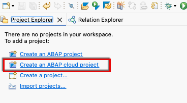
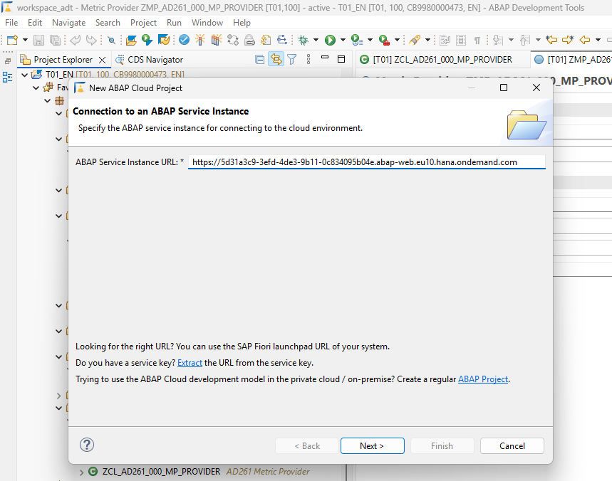
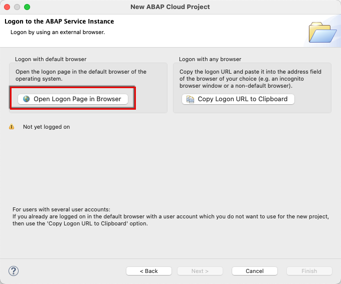
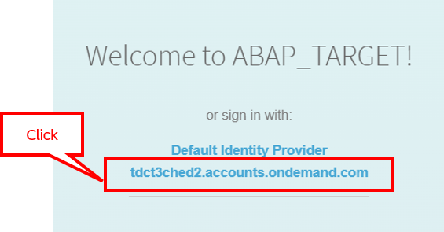
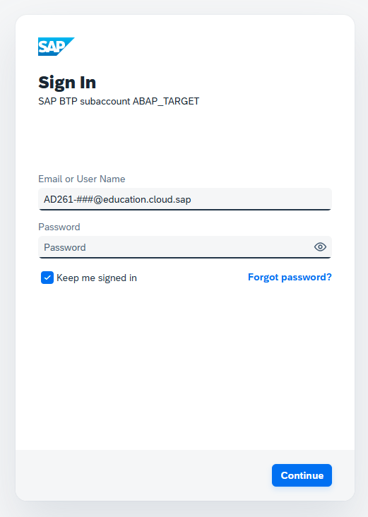
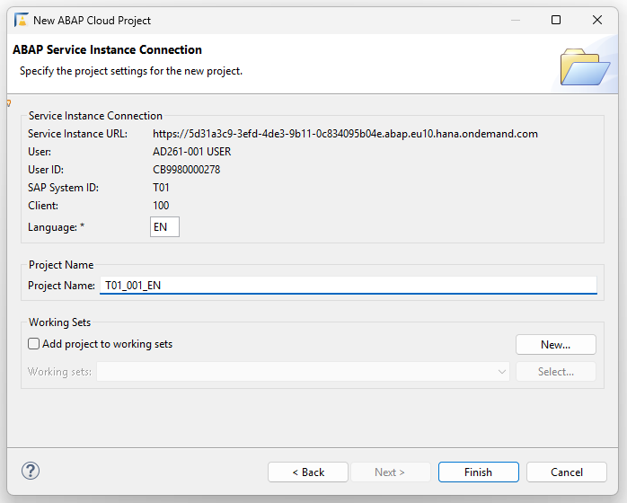
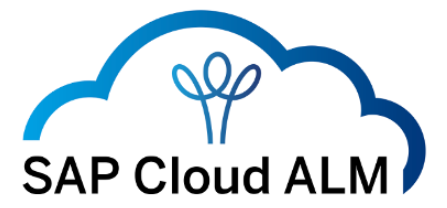
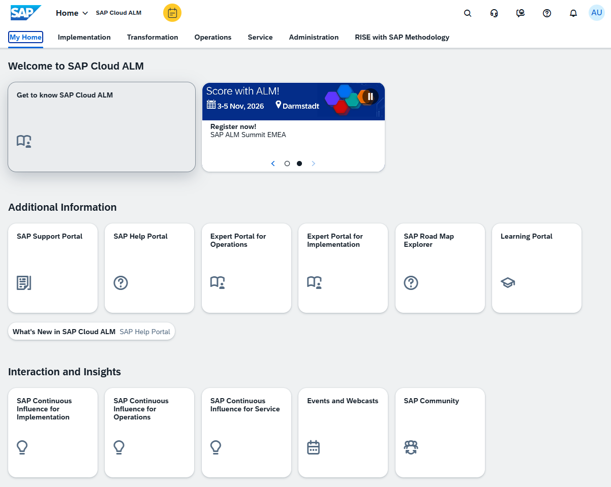

[Home - AD261](/README.md)

# Getting Started

## Introduction

In this exercise, you will choose a unique suffix for your development objects and verify whether your development environment is ready.

### Required Steps

- [0.1 - Choose Your Unique Suffix](#getting-started-01-choose-your-unique-suffix)
- [0.2 - SAP Business AI Platform, ABAP environment](#getting-started-02-sap-business-ai-platform-abap-environment)
- [0.3 - SAP Cloud ALM](#getting-started-03-sap-cloud-alm)
- [Summary & First Exercise](#summary-first-exercise)

> ℹ️ **Reminder**: Don't forget to replace all occurrences of the placeholder **`###`** with your group ID in the exercise steps below.

## Getting Started 0.1: Choose Your Unique Suffix

> Use your seat place number **`##`** and add a leading **`0`** to determine your unique suffix **`0##`** that you will use throughout all exercises to make your development objects unique.

  
 🔵 Click to expand!

For example:

- Seat number: **`46`**
- Suffix: **`046`**

⚠️ Only use the suffix you have received from the instructors. Please **DO NOT USE** any suffix other than the one assigned to you.

## Getting Started 0.2: SAP Business AI Platform, ABAP environment

> Create an **ABAP Cloud Project** in your ADT installation to connect it to the provided **SAP Business AI Platform, ABAP environment** system.

  
 🔵 Click to expand!

### Logon Information

| Field | Value |
| --- | --- |
| **System** | `T01` — _The SAP system URL will be provided in the handout!_ |
| **User** | `AD261-###@education.cloud.sap` |
| **Password** | Provided in the session (see handout) |
| **Exercise Package** | **`ZAD261_###`** |

> ⚠️ Replace **all** occurrences of **`###`** with your personal suffix throughout all exercise steps.
> **Check the suffix `###` of your demo user (e.g. AD261-###@education.cloud.sap).**
> Only perform changes in your package **`ZAD261_###`**.

 -----

### Fiori Launchpad

 

1. Open your browser for the URL: _The SAP system URL will be provided in the handout!_

2. Log on using the credentials from the Logon Information above (replace `###` with your group number):
   - **User:** `AD261-###@education.cloud.sap`
   - **Password:** Provided in the session (see handout)

### ABAP Development Tools

1. Start **ABAP Development Tools (ADT)**.

2. Create a new Cloud Project via **`Create an ABAP cloud project`**.

   

3. Enter the URL of system `T01` and click **`Next`**.

   _The SAP system URL will be provided in the handout!_

    

   

4. Log on using the credentials from the Logon Information above (replace `###` with your group number):
   - **User:** `AD261-###@education.cloud.sap`
   - **Password:** Provided in the session (see handout)

    

   > 💡 Choose the identity provider starting with **`tdct3...`** in the browser to sign in, if requested.
   >     
   > 

       

   

5. Complete the **New ABAP Cloud Project** creation wizard.

   

## Getting Started 0.3: SAP Cloud ALM

> **SAP Cloud Application Lifecycle Management** (SAP Cloud ALM) is the central tool to monitor your ABAP Cloud apps. Verify that you can access the preconfigured **SAP Cloud ALM instance**.

  
 🔵 Click to expand!

### Logon Information

| Field | Value |
| --- | --- |
| **Service** | _The URL will be provided in the handout!_ |
| **User** | `AD261-###@education.cloud.sap` |
| **Password** | Provided in the session (see handout) |

### Logon and Connect

1. Open the following URL in your browser: _The URL will be provided in the handout!_

2. Log on using the credentials from the Logon Information above (replace `###` with your group number):
   - **User:** `AD261-###@education.cloud.sap`
   - **Password:** Provided in the session (see handout)

3. After logging on, you should see this welcome page.

   

## Summary & First Exercise

Now that you have:

- chosen your unique suffix **`###`**,
- connected to the ABAP environment,
- connected to SAP Cloud ALM, and
- verified that your development environment is ready,

you can continue with the first exercise ► **[Exercise 1: Create a Console Application](../exercise-01/readme.md)**.
